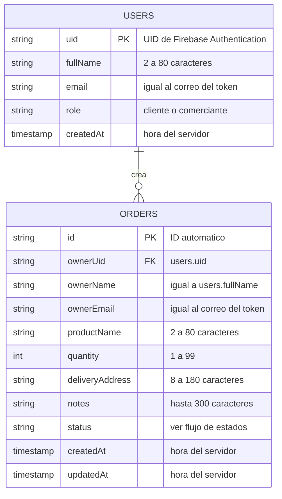
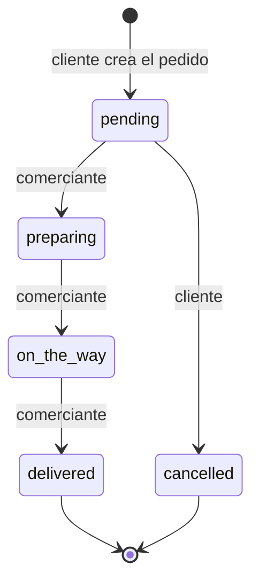

# Diagrama entidad-relacion

MercadoVecino usa dos colecciones de Cloud Firestore: `users` y `orders`. Cada usuario puede crear muchos pedidos y cada pedido pertenece a un solo usuario, enlazado por `ownerUid`.

La fuente editable del diagrama esta en [`diagrams/data-model.mmd`](diagrams/data-model.mmd).

## Relacion

| Desde | Hacia | Cardinalidad | Campo | Regla que la protege |
| --- | --- | --- | --- | --- |
| `users` | `orders` | 1 a muchos (0..n) | `orders.ownerUid` = `users/{uid}` | `isOwner(request.resource.data.ownerUid)` al crear el pedido |

Firestore no tiene llaves foraneas. La relacion se garantiza con las reglas: un pedido solo se puede crear con el `ownerUid` del usuario autenticado y con el `ownerName` de su perfil.

## Flujo de estados de `orders.status`

Ver el detalle de cada campo en el [diccionario de datos](diccionario-datos.md).
