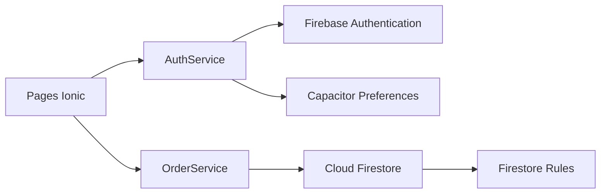
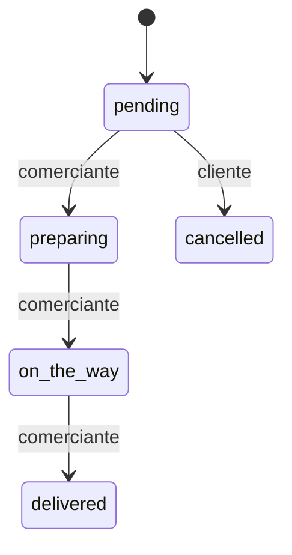

# Arquitectura y datos

MercadoVecino es una aplicación Ionic + Angular de componentes standalone. No tiene backend propio: Firebase Authentication identifica al usuario y Cloud Firestore conserva perfiles y pedidos.

## Colecciones

| Colección | Documento | Campos principales |
| --- | --- | --- |
| `users` | UID de Firebase Auth | `fullName`, `email`, `role`, `createdAt` |
| `orders` | ID automático | `ownerUid`, `ownerName`, `ownerEmail`, `productName`, `quantity`, `deliveryAddress`, `notes`, `status`, `createdAt`, `updatedAt` |

## Roles y navegación

| Rol | Rutas permitidas | Operaciones |
| --- | --- | --- |
| `cliente` | `/orders`, `/orders/new`, `/orders/:id` | crear, listar/detallar los propios y cancelar uno pendiente |
| `comerciante` | `/manage-orders` | listar pedidos y avanzar su estado |

El menú y los guards ofrecen la experiencia adecuada; las reglas de Firestore son la autorización definitiva.

## Operaciones de datos

| Servicio | Operación | Colección | Resultado |
| --- | --- | --- | --- |
| `AuthService` | `register` | `users` | crea usuario Auth y perfil cliente |
| `AuthService` | `login` | `users` | obtiene perfil y guarda sesión local mínima |
| `OrderService` | `create` | `orders` | crea un pedido `pending` del usuario actual |
| `OrderService` | `customerOrders` | `orders` | lista propia en tiempo real |
| `OrderService` | `orderById` | `orders` | observa el detalle en tiempo real |
| `OrderService` | `merchantOrders` | `orders` | lista para el comerciante |
| `OrderService` | `updateStatus` | `orders` | avanza el flujo del comerciante |
| `OrderService` | `cancel` | `orders` | marca un pendiente como `cancelled` |

## Estados

