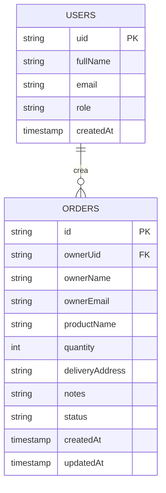

# Diccionario de datos

MercadoVecino guarda sus datos en Cloud Firestore en dos colecciones: `users` y `orders`. Este documento describe cada campo tal como lo escribe la aplicacion (`AuthService` y `OrderService`) y tal como lo exige [firestore.rules](../../firestore.rules).

Fuente del diagrama: [`docs/diagrams/data-model.mmd`](../diagrams/data-model.mmd).

## Coleccion `users`

Perfil de cada cuenta. El ID del documento es el UID de Firebase Authentication, asi que existe como maximo un perfil por cuenta.

| Campo | Tipo | Obligatorio | Restricciones | Quien lo escribe | Descripcion |
| --- | --- | --- | --- | --- | --- |
| *(ID del documento)* | string | Si | Igual a `request.auth.uid` | `AuthService.register` | UID de Firebase Authentication. Modelo: `UserProfile.uid`. |
| `fullName` | string | Si | De 2 a 80 caracteres; se guarda sin espacios al inicio ni al final | `register` | Nombre que se muestra en el menu y se copia a cada pedido como `ownerName`. |
| `email` | string | Si | Debe ser igual al correo del token de autenticacion | `register` | Correo de la cuenta. |
| `role` | string | Si | `cliente` o `comerciante`. Al crearse solo se acepta `cliente` | `register` | Define las rutas y operaciones permitidas. |
| `createdAt` | timestamp | Si | Tipo timestamp | `register` (`serverTimestamp()`) | Fecha de registro. |

**Notas**

- **El rol `comerciante` no se asigna desde la app.** Para crear un comerciante, se registra la cuenta como cliente y luego se cambia `role` a `comerciante` desde la consola de Firebase. Las reglas no permiten que el usuario cambie su propio rol.
- **Despues del registro solo se puede editar `fullName`**, y solo el dueno del perfil. La app todavia no tiene pantalla de edicion de perfil.
- **Los perfiles no se pueden borrar desde la app** (`allow delete: if false`).
- **En el dispositivo se guarda una copia minima del perfil** (`AppSession`: `uid`, `fullName`, `email`, `role`) en Capacitor Preferences, con la clave `mercado-vecino-session`. Esa copia solo sirve para la navegacion; no da permisos sobre los datos.

## Coleccion `orders`

Pedidos de los clientes. El ID del documento lo genera Firestore (`addDoc`).

| Campo | Tipo | Obligatorio | Restricciones | Quien lo escribe | Descripcion |
| --- | --- | --- | --- | --- | --- |
| *(ID del documento)* | string | Si | Automatico | Firestore | Se usa en la ruta `/orders/:id`. Modelo: `Order.id`. |
| `productName` | string | Si | De 2 a 80 caracteres | `OrderService.create` | Producto solicitado, en texto libre. |
| `quantity` | int | Si | Entero de 1 a 99 | `create` | Cantidad solicitada. |
| `deliveryAddress` | string | Si | De 8 a 180 caracteres | `create` | Direccion de entrega. |
| `notes` | string | Si | Hasta 300 caracteres; puede ser vacio | `create` | Indicaciones adicionales. |
| `ownerUid` | string | Si | Igual a `request.auth.uid` | `create` | Referencia a `users/{uid}`, el cliente que hizo el pedido. |
| `ownerName` | string | Si | Tipo string | `create` | Copia de `fullName` del cliente, para que el comerciante vea el nombre sin leer `users`. |
| `ownerEmail` | string | Si | Igual al correo del token | `create` | Copia del correo del cliente. |
| `status` | string | Si | Al crearse: `pending`. Luego cambia segun el flujo de estados | `create`, `updateStatus`, `cancel` | Estado actual del pedido. |
| `createdAt` | timestamp | Si | Tipo timestamp | `create` (`serverTimestamp()`) | Fecha de creacion. Las listas se ordenan por este campo de forma descendente. |
| `updatedAt` | timestamp | Si | Tipo timestamp; se renueva en cada cambio de estado | `create`, `updateStatus`, `cancel` | Fecha del ultimo cambio. |

### Valores de `status`

| Valor | Etiqueta en la app | Color del badge | Quien lo asigna | Desde |
| --- | --- | --- | --- | --- |
| `pending` | Pendiente | `primary` | Cliente (al crear) | — |
| `preparing` | Preparando | `primary` | Comerciante | `pending` |
| `on_the_way` | En camino | `primary` | Comerciante | `preparing` |
| `delivered` | Entregado | `success` | Comerciante | `on_the_way` |
| `cancelled` | Cancelado | `medium` | Cliente | `pending` |

`delivered` y `cancelled` son estados finales. Los pedidos no se borran: cancelar es un borrado logico que conserva el historial.

## Indices

| Coleccion | Campos | Consulta que lo usa |
| --- | --- | --- |
| `orders` | `ownerUid` ASC, `createdAt` DESC | `OrderService.customerOrders`: pedidos del cliente, del mas reciente al mas antiguo. |

Esta definido en [firestore.indexes.json](../../firestore.indexes.json). La consulta del comerciante (`merchantOrders`) solo ordena por `createdAt` y usa el indice automatico de un campo.

## Coherencia entre formulario, reglas y modelo

| Campo | Validacion del formulario | Validacion de las reglas |
| --- | --- | --- |
| `fullName` | Obligatorio, minimo 2 | De 2 a 80 |
| `productName` | Obligatorio, de 2 a 80 | De 2 a 80 |
| `quantity` | Obligatorio, de 1 a 99 | Entero de 1 a 99 |
| `deliveryAddress` | Obligatorio, de 8 a 180 | De 8 a 180 |
| `notes` | Maximo 300 | Maximo 300 |

**Observacion:** el formulario de registro no limita `fullName` a 80 caracteres, pero las reglas si. Si alguien escribe un nombre mas largo, la cuenta de Authentication se crea, la escritura del perfil se rechaza y `AuthService` cierra la sesion. La cuenta queda creada sin perfil y ese correo ya no se puede volver a registrar. Se corrige en el PR de la MER-3, que agrega `Validators.maxLength(80)` en `register.page.ts`.
